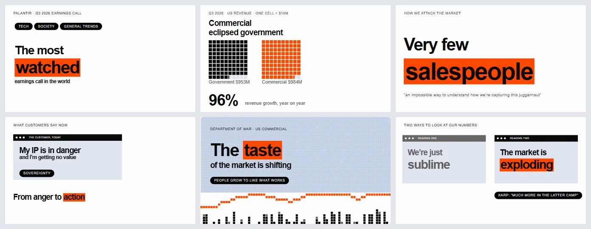

<h1></h1>

Palantir-inspired animated HTML slides. By default, each slide reveals its content automatically and waits for a manual page turn. The deck is a single HTML file that runs offline.

An independent open-source project inspired by Palantir’s presentation style. Not affiliated with or endorsed by Palantir Technologies.

## Original reference deck

[Download the original 31-slide HTML deck](https://raw.githubusercontent.com/kuaizengji/pltr-deck/main/examples/palantir-original.html) and open it in a browser. This deck is a visual reference. New decks start from [the reusable template](assets/deck.html).

## Try it

Download [the two-slide example](examples/onboarding.html) and open it in a browser. Click, press Space, or use the arrow keys to navigate. Press **F** for fullscreen and **Esc** to exit.

## Make a deck

Follow [SKILL.md](SKILL.md) with a brief or speaker notes, or copy [the template](assets/deck.html) and replace the slide marker using the [layout reference](references/layout.md).

## Customize a deck

| Role | Default | Used for |
| --- | --- | --- |
| Canvas (`--paper`) | `#fdfdfd` | Slide background and light text on dark UI |
| Foreground (`--ink`) | `#0b0b0b` | Headings, dark capsules, window headers, and primary grid cells |
| Accent (`--accent`) | `#ff4800` | Keyword highlights and emphasized data marks |
| Surface (`--surface`) | `#e0e5ef` | Cool blue-gray panels, secondary grid cells, and tonal backgrounds |

Edit the four CSS variables in `:root`. Check contrast for text on the canvas, on the accent, and inside dark capsules and light panels.

Set `data-reveal="manual"` on `<html>` to step through builds with Right, Space, or a click. Left goes back one build. Page Up and Page Down always turn the whole page. With `data-reveal="auto"`, builds play automatically and those navigation controls turn pages.

To add a brand, put an `` inside `<template id="deck-brand">`. Use the original logo asset as a PNG or SVG data URL to keep the file portable offline, and set a descriptive `alt`. The logo appears in the upper-right corner of every slide. Add the `bottom-right` class to move it to the lower right. Leave the template empty for an unbranded deck.

See a [custom palette, logo, and manual-reveal example](examples/branded-manual.html).

MIT licensed.
